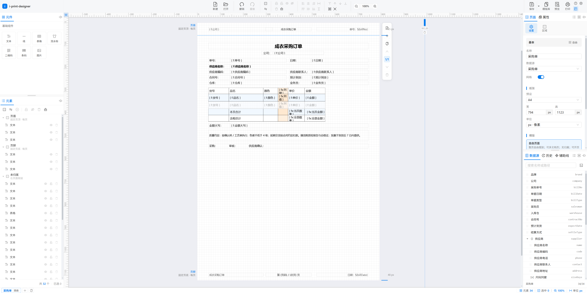

# i-print-designer

**Web 打印设计器**：在浏览器里设计单据、标签、小票、报表等可打印版式，支持预览、导出与打印。可独立部署完整站点，也可把单文件 SDK 嵌进现有业务系统。



## 产品能力

- **两种页面布局**：自由布局（坐标摆放，适合标签 / 单据）与流式布局（纵向流式排版）
- **所见即所得画布**：拖拽元件、对齐均分、图层组合、辅助线吸附、缩放与多页纸带
- **数据源绑定**：字段树、循环行、函数与页号等，设计与业务数据分离
- **预览与输出**：设计器内预览、导出分页 HTML、系统打印
- **两种接入形态**
  - **完整站点**（`dist/`）：含 Monaco 等完整编辑能力，适合独立打开或 iframe 隔离
  - **单文件 SDK**（`dist-demo/sdk/`）：嵌进宿主页，直接 `mount` / `api.xxx` 调用

## 本包内容

| 目录 | 说明 |
|------|------|
| `dist/` | 主应用整站产物（打开即可用完整设计器） |
| `dist-demo/` | 单文件 SDK + 可运行 DEMO（embed / iframe） |
| `assets/` | 产品示意与联系二维码 |

本地快速打开：

```bash
npx serve dist -p 4173        # 完整设计器 → http://localhost:4173/
npx serve dist-demo -p 4174   # SDK DEMO   → http://localhost:4174/embed/
```

## 接入与 API

具体挂载方式、完整 API、DEMO 说明请看：

**→ [`dist-demo/README.md`](./dist-demo/README.md)**

其中包含：

- 方式 A：单文件 SDK 嵌入业务页（参考 `dist-demo/embed/`）
- 方式 B：iframe + `postMessage`（参考 `dist-demo/iframe/`，需配合 `dist/`）
- `mount` / `load` / `setData` / 预览 / 打印 / 保存回调等用法

---

## 交流与支持

欢迎加群或加好友交流使用问题与需求。

**QQ 群**：`1105546827`

**微信**：`xinnianpeng`（加好友时请备注来意；也可扫码）


